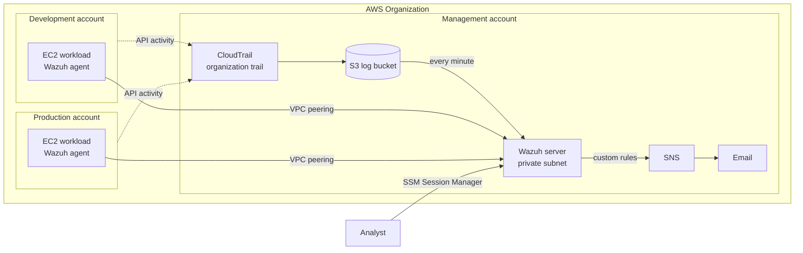

# Multi-Account AWS Threat Detection with Wazuh

A Wazuh SIEM, deployed with Terraform, that monitors an AWS Organization. It collects CloudTrail activity from every account and host telemetry from the workloads, runs custom detection rules mapped to MITRE ATT&CK, and validates them with attack simulations.

## Architecture



## How it works

- **Cloud telemetry:** an organization trail records management events from all accounts and regions in S3. Wazuh's AWS module reads it every minute with the instance role.
- **Host telemetry:** each member account runs an EC2 workload with the Wazuh agent, reporting over VPC peering. File integrity monitoring watches SSH `authorized_keys` in real time.
- **Detection:** custom rules mapped to MITRE ATT&CK. Their alerts are emailed through SNS; Wazuh's built-in rules stay in the dashboard.
- **Network:** every instance sits in a private subnet with no inbound access from the internet and no SSH keys. Outbound traffic leaves through a NAT gateway, S3 traffic through a gateway endpoint, and administration happens over SSM Session Manager.
- **Delivery:** Terraform runs in GitHub Actions with OIDC, so no AWS keys are stored. Pull requests run `plan`; merges to `main` run `apply`.

## Detections

| # | MITRE ATT&CK | Detection | Simulated with | Evidence |
|---|---|---|---|---|
| 1 | T1562.008 Disable or Modify Cloud Logs | CloudTrail logging stopped or trail deleted | Stratus Red Team `aws.defense-evasion.cloudtrail-stop` | pending |
| 2 | T1098.001 Additional Cloud Credentials | Access key created for an IAM user | Stratus Red Team `aws.persistence.iam-backdoor-user` | pending |
| 3 | T1098.003 Additional Cloud Roles | `AdministratorAccess` attached to an IAM user | Stratus Red Team `aws.persistence.iam-create-admin-user` | pending |
| 4 | T1537 Transfer Data to Cloud Account | EBS snapshot shared with another account | Stratus Red Team `aws.exfiltration.ec2-share-ebs-snapshot` | pending |
| 5 | T1098.004 SSH Authorized Keys | `authorized_keys` changed on a workload | Manual change through SSM | pending |

## Design decisions

- **Wazuh in the management account.** This keeps the lab to three accounts. In production, Wazuh would run in a dedicated security account registered as delegated administrator.
- **One NAT gateway per VPC, in a single AZ.** VPC peering is not transitive, so each VPC needs its own egress. Production would add one NAT gateway per AZ.
- **Detection latency.** Polling every minute leaves CloudTrail's delivery to S3, about 5 minutes, as the floor. FIM alerts arrive in seconds.
- **Pipeline role with AdministratorAccess.** The pipeline creates IAM, network, compute and organization-level resources across three accounts. The OIDC trust limits the role to this repository's `main` branch and pull requests.
- **Agent enrollment without a password.** Only the monitored VPCs can reach ports 1514 and 1515.
- **No account identifiers in the repository or in the public logs.** They come from GitHub secrets, are marked sensitive in Terraform and are masked in the workflow.
- **Cost.** About US$ 5 for a 12-hour run: one t3.xlarge server, two t3.small workloads and three NAT gateways.

## Repository layout

```
terraform/            Root module, network and spoke modules, boot scripts
wazuh/integrations/   SNS alert integration
wazuh/rules/          Custom detection rules
.github/workflows/    Plan, apply and destroy pipeline
docs/screenshots/     Evidence
```

## Stack

AWS Organizations, CloudTrail, EC2, VPC, SNS, Systems Manager · Wazuh 4.14 · Terraform · GitHub Actions · Stratus Red Team
